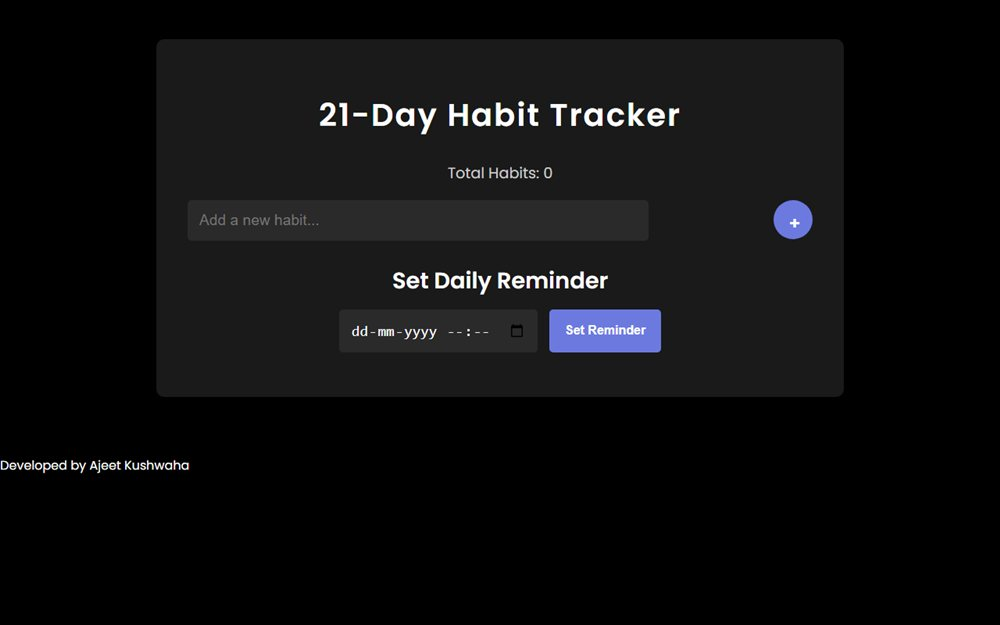

# 21-Day Habit Tracker

A no-account habit tracker: 21 days, one grid, everything stored in your own browser.

**[Open the live site](https://ajeet-iitk.github.io/HabitTracker/)**

## What it does

Twenty-one days is long enough to feel like a habit and short enough to actually finish. The grid gives you one square per day; click it when you show up. Nothing leaves the browser - there is no login and no server.

## Features

- 21-day grid, one click per day
- Progress saved locally, so closing the tab loses nothing
- Streak and completion feedback
- Custom favicon and a light, single-page layout

## Run locally

Open `index.html`, or use the hosted copy:

<https://ajeet-iitk.github.io/HabitTracker/>

## Files

| File | Purpose |
| --- | --- |
| `index.html` | Page structure |
| `script.js` | State and storage |
| `style.css` | Styling |
| `favicon.ico` | Site icon |

---

Part of [my collection of small projects](https://github.com/Ajeet-iitk).
